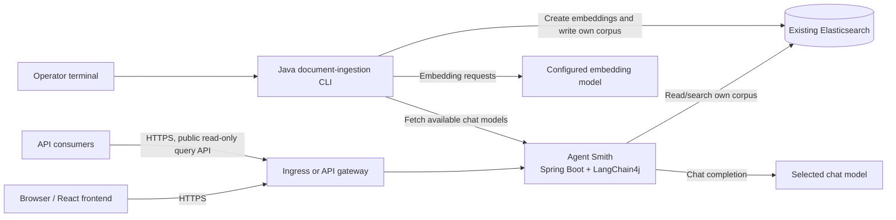

# Agent Smith RAG Architecture Plan

## 1. Purpose and current baseline

Add retrieval-augmented generation (RAG) to Agent Smith without replacing the
existing application stack:

- Java 25 and Maven.
- Spring Boot 4.1.1 with the existing MVC and Actuator starters.
- LangChain4j 1.22.0, including the existing Gemini chat-model integration.
- The React/Vite frontend, packaged as Spring Boot static resources.
- An existing Elasticsearch service. Elasticsearch is external to this
  application and is not deployed as part of the Agent Smith containers.

The current application exposes `/descrivi` and `/moduli`; it does not yet
provide document ingestion, embeddings, vector retrieval, or a RAG API. Add a
separate Java terminal application to ingest documents. Agent Smith itself
retrieves its own corpus and generates answers; it does not ingest documents
or access other applications' RAG configuration.

### Step 1 compatibility findings and contracts

- The project already uses `langchain4j` and
  `langchain4j-google-ai-gemini` 1.22.0. That Gemini module includes
  `GoogleAiEmbeddingModel` as well as chat-model support, but the selected
  embedding model and its dimensions still require confirmation.
- Maven Central does not publish `dev.langchain4j:langchain4j-elasticsearch`
  at version `1.22.0`. Its corresponding adapter is published as
  `1.22.0-beta32`, depends on LangChain4j core `1.22.0`, and brings the
  Elasticsearch Java client `9.3.1`. Treat this as a compatibility candidate,
  not a confirmed production choice, until it is tested against the actual
  Elasticsearch server and its vector APIs.
- The repository does not identify the Elasticsearch server version, vector
  capabilities, selected embedding model/dimensions, or similarity metric.
  Supply and verify these before choosing the adapter, creating an index
  mapping, or enabling RAG.
- `GET /moduli` is a JSON array of objects with `id` and `nome` fields. `id`
  is the exact opaque selection value (`gemini:<provider-model-id>` or
  `openwebui:<provider-model-id>`); `nome` is display-only. The CLI must save
  and submit the exact `id`, never derive an identifier from the display name.
- The RAG answer model is an operator-managed, persistent Agent Smith-wide
  default, not a per-query choice. The operator selection must be checked
  against the current `/moduli` catalog when saved and before it is used.
  Query requests do not accept a model override. This chat-model selection is
  independent of the embedding model. The operator configuration API and
  durable selection store are implemented in later steps below.
- Ingestion does not restrict filenames by extension. It attempts to read
  every regular file as bounded UTF-8 text, including extensionless files and
  unfamiliar suffixes; unreadable, binary, malformed UTF-8, and oversized
  files are reported and skipped. No file is executed or passed to an
  executable/format-specific parser.
- File size means raw bytes. A file at or below 5,000 bytes is one snippet;
  larger files are chunked. RAG is disabled by default until the remaining
  infrastructure and model prerequisites are verified.

### Step 2 Elasticsearch boundary and outstanding provisioning

- The application runtime configuration uses `ELASTICSEARCH_URL`,
  `AGENTSMITH_ES_READ_API_KEY`, and `RAG_INDEX_ALIAS`. The URL must be HTTPS;
  Java's normal trust validation remains enabled, and credentials embedded in
  URLs or sent over HTTP are rejected. The runtime has no write credential.
- The future CLI binds its own `agentsmith.ingestion.elasticsearch` settings
  from `ELASTICSEARCH_URL`, `AGENTSMITH_ES_WRITE_API_KEY`, and
  `RAG_INDEX_ALIAS`. It must not reuse or receive the runtime read key. The
  CLI config validates the same Agent Smith alias scope before writes.
- Alias names are restricted to `agentsmith-rag-v1-` followed by lowercase
  letters, digits, `.`, `_`, or `-`; the default active alias is
  `agentsmith-rag-v1-active`. Physical index resources must remain in the
  `agentsmith-rag-v1-*` family. Missing endpoint/read credentials prevent
  RAG from being enabled; there is no unscoped fallback.
- No Elasticsearch index template, mapping, or security-role files were
  generated because the server version, vector field capabilities, embedding
  dimensions, and similarity metric remain unknown. Before enabling the
  feature, the Elasticsearch administrator must confirm those facts; create
  a version-compatible template/mapping and physical index in the dedicated
  family, attach the active alias, and provision separate API keys/roles:
  runtime gets only search/read privileges on that family; the CLI gets only
  the minimum index/document create, write, and deletion privileges required
  for ingestion and stale-chunk cleanup. Neither identity gets cluster
  administration or privileges on other applications' resources. Verify
  TLS certificate trust and both positive and negative role boundaries.

### Step 3 API authorization boundary

- RAG read/query routes are intentionally public and do not require
  authentication. Only state-changing RAG configuration routes under
  `/api/rag/config` require the `ROLE_RAG_OPERATOR` authority. Unrelated routes
  remain permitted, preserving the existing `/descrivi` and `/moduli` behavior.
- Enable operator authorization with `AGENTSMITH_RAG_SECURITY_ENABLED=true`
  and supply the dedicated CLI operator identity using
  `AGENTSMITH_RAG_OPERATOR_USERNAME` and
  `AGENTSMITH_RAG_OPERATOR_PASSWORD_HASH` (a `{bcrypt}`-prefixed hash, not a
  plaintext password). Keep these credentials only in the CLI's approved
  secret source; do not distribute them to read-only API callers. Without
  operator authorization configured, configuration writes are denied while
  RAG reads remain public.
- HTTP authentication cannot prove that a request originated from a specific
  CLI executable. The operator credential is therefore a CLI-only secret by
  deployment policy; protect it accordingly and use TLS ingress. Security is
  stateless, disables CSRF for this API, and adds no Elasticsearch credentials
  or ingestion operations to public endpoints.

### Step 4 retrieval and answer API

- Added `POST /api/rag/query` as a public read-only route, available only when
  `AGENTSMITH_RAG_ENABLED=true`. Its JSON request is `{"question":"..."}`;
  questions are required and limited to 4,000 characters by default. The
  response contains `answer` and `sources`; each source exposes only
  `sourceId`, relative `path`, and `startLine`/`endLine`, never retrieved
  document text. No results return a grounded no-match answer without calling
  a chat model.
- Retrieval uses the configured Gemini embedding model with the
  `RETRIEVAL_QUERY` task type, checks the produced vector dimension, and sends
  a kNN search only to the validated Agent Smith alias. The index contract
  uses `embedding` (dense vector), `text`, `sourceId`, `path`, `startLine`,
  and `endLine` fields. The embedding model/dimension and compatible
  Elasticsearch kNN/mapping remain deployment prerequisites; the feature
  stays disabled by default.
- The answer model is the operator-selected durable ID, validated against the
  available `/moduli` provider catalog when configured and when answering.
  `RAG_ANSWER_MODEL_ID` supplies the initial fallback; the operator API
  persists later selections in `AGENTSMITH_RAG_CONFIG_FILE`. The
  embedding model is configured separately via `EMBEDDING_MODEL` and
  `EMBEDDING_DIMENSIONS`. `GEMINI_API_KEY`, the read-only
  `AGENTSMITH_ES_READ_API_KEY`, and `ELASTICSEARCH_URL` are required for an
  enabled service. Model instructions mark retrieved material as untrusted
  reference data and prohibit following instructions found in it.
- Search results are size-limited, checked for valid source IDs and safe
  relative paths, and context is capped at 20,000 characters by default.
  Returned source references are deduplicated. Backend errors return a
  generic response and do not include search response bodies, retrieved text,
  or credentials in API error messages.

### Step 5 separate document-ingestion CLI

- The independent `DocumentIngestionCli` entry point is packaged as
  `target/AgentSmith-cli.jar`; its executable archive uses the Spring Boot
  launcher but starts the CLI rather than the web application. Build it with
  Java 25 using `mvn package`, then run:

  ```sh
  java -jar target/AgentSmith-cli.jar
  ```

- The CLI requires `AGENTSMITH_BASE_URL`, `AGENTSMITH_RAG_OPERATOR_USERNAME`,
  `AGENTSMITH_RAG_OPERATOR_PASSWORD`, `ELASTICSEARCH_URL`, and
  `AGENTSMITH_ES_WRITE_API_KEY`. Ingestion also requires `GEMINI_API_KEY`,
  `EMBEDDING_MODEL`, and positive `EMBEDDING_DIMENSIONS`.
  `RAG_INDEX_ALIAS` defaults to `agentsmith-rag-v1-active`. The CLI accepts
  HTTPS Agent Smith URLs; plain HTTP is accepted only for localhost/loopback
  development. Elasticsearch must always use HTTPS. The CLI uses only its
  write-scoped Elasticsearch key, never `AGENTSMITH_ES_READ_API_KEY`.
- The operator configures server-side security with
  `AGENTSMITH_RAG_SECURITY_ENABLED=true`, the matching operator username, and
  a `{bcrypt}`-prefixed `AGENTSMITH_RAG_OPERATOR_PASSWORD_HASH`. Give the
  plaintext operator password only to the CLI through its secret source.
- The CLI uses standard Java input/output classes only. For directory
  completion, enter a partial path followed by Tab and Enter; unique matches
  are expanded and ambiguous matches are listed for retry. The CLI resolves
  the selected path and requires explicit `YES` confirmation, fetches the JSON
  model catalog from `/moduli`, and displays letter/model choices in three
  columns no wider than 80 terminal columns. Names and IDs wrap rather than
  truncate; catalogs larger than 26 entries are paginated with `next`/`prev`.
  The selected opaque model ID is posted to the operator-only
  `POST /api/rag/config` operation after catalog validation.
- The server persists only the selected chat-model ID in the file configured
  by `AGENTSMITH_RAG_CONFIG_FILE` (default
  `./data/agentsmith-rag.properties`); mount that location on persistent
  storage in deployments. This file contains no credentials.

### Step 6 recursive ingestion and indexing

- After directory confirmation and model selection, the CLI recursively scans
  without following symbolic links. It makes no extension-based exclusions:
  every regular file, including extensionless files and unfamiliar suffixes,
  is attempted as text. It reports unreadable, malformed UTF-8, binary, and
  over-limit files, and never executes files or invokes format-specific parsers.
- The raw-byte threshold is inclusive: files at or below 5,000 bytes produce
  exactly one snippet. Larger files are split at newline/technical delimiters,
  with a target of 4,000 characters and up to 300 characters of overlap. Each
  chunk includes line locations. A per-file maximum of 5 MiB and per-run
  limits of 10,000 files and 20,000 filesystem entries bound resource use.
- Chunk embeddings use `EMBEDDING_MODEL`, `EMBEDDING_DIMENSIONS`, and
  `GEMINI_API_KEY`, with the Gemini `RETRIEVAL_DOCUMENT` task type; these
  remain distinct from query embedding and the selected chat model.
- `sourceId`/`fileId` are deterministic SHA-256 identifiers of the canonical
  corpus root and normalized relative path. Elasticsearch document IDs are
  deterministic per file and chunk number, so re-ingestion overwrites current
  chunks. The stored document also includes `corpusId`, `contentHash`, and
  `chunkIndex` version fields.
- The CLI uses only its HTTPS write-scoped Elasticsearch API key. Bulk writes
  target the validated Agent Smith alias. After successful file indexing,
  stale chunk indices are removed; after a clean full scan, documents for
  files no longer present in that corpus are removed. Corpus-wide deletion is
  skipped if any scan/read/embed/index error occurred, retaining prior data
  rather than risking deletion based on an incomplete scan.
- Because the Elasticsearch server/version and vector capabilities are still
  unconfirmed, external setup must map `embedding`, `text`, `sourceId`,
  `path`, `startLine`, `endLine`, `corpusId`, `fileId`, `contentHash`, and
  numeric `chunkIndex` compatibly, with exact/keyword mappings for identifier
  fields and the configured vector dimensions. The CLI's bulk indexing and
  `_delete_by_query` operations must be covered by the dedicated least-
  privilege write role. No live-cluster compatibility or role test has yet
  been performed.

### Step 7 operational readiness, limits, and metrics

- Spring Boot Actuator exposes `/actuator/health`, `/livez`, and `/readyz`.
  Liveness reports application process health; readiness includes the RAG
  configuration indicator, which reports the disabled feature as ready and
  validates required settings when RAG is enabled. It deliberately does not
  make network calls to Elasticsearch or an AI provider. A healthy probe
  therefore does not certify external dependency availability or index
  compatibility. Health details are never returned.
- `/actuator/metrics` is exposed only to authenticated RAG operators; it is
  denied when operator authorization is not configured. Health and probe
  endpoints remain readable without credentials and disclose no configuration
  values. Keep ingress/network policy in place so operator-only endpoints are
  not publicly reachable.
- RAG query, embedding, retrieval, answer-generation, ingestion-run, file,
  chunk, and failure metrics use bounded operation/outcome names. Questions,
  model IDs, document paths, and content are never metric tags.
- Outbound HTTP clients use a 5-second connection timeout and 30-second
  response timeout. Gemini query/document embedding and RAG answer calls have
  their own 30-second model timeout. HTTP error logging reports operation and
  exception type only; ingestion logs report counts only. CLI progress may
  show the operator-selected local path and filenames, but no credentials or
  document contents are logged.
- The ingestion resource limits are 5 MiB per file, 10,000 files, and 20,000
  filesystem entries per run. Query limits are 4,000 question characters, 20
  results, and 100,000 context characters maximum; defaults are 5 results and
  20,000 context characters. The CLI and API process one request/run at a
  time; impose platform request-rate and concurrency limits at the ingress for
  public query traffic.
- Index changes use versioned indices behind the configured active alias.
  Provision and validate the next mapping/vector dimensions, re-ingest the
  corpus into the new index, verify sample retrieval and source metadata, then
  atomically move the alias. Retain the previous index through the rollback
  window; if validation fails, move the alias back and investigate before
  deleting either index. Changing embedding model or dimensions requires a
  compatible new mapping and full re-ingestion; do not mix vectors from
  incompatible models in one active index.
- Re-ingestion is safe to repeat: stable document IDs overwrite matching
  chunks, and stale chunks/files are deleted only after the relevant file or
  full-corpus work completes successfully. If a run reports issues, resolve
  them and rerun before considering the corpus current; incomplete runs
  intentionally skip corpus-wide deletion.

## 2. Target architecture



Agent Smith serves the existing UI/API and the RAG query API in its Spring
Boot container. The companion CLI runs interactively on an authorized
operator's Ubuntu workstation or as an explicitly invoked one-shot container.
It is a separate executable entry point and security identity, not an
always-running service. Both programs use the existing Elasticsearch cluster
but receive different least-privilege credentials.

### Query flow

1. A client submits a question to Agent Smith's public read-only RAG API.
2. Agent Smith embeds the question with the configured embedding model and
   searches only its own Elasticsearch index/alias.
3. Agent Smith passes the retrieved snippets and question to its selected chat
   model, then returns an answer and permitted source references.
4. Other applications query Agent Smith through this public read-only API;
   they do not receive Elasticsearch credentials or access the cluster
   directly through Agent Smith.

### Ingestion flow

1. The operator launches the CLI and enters a document directory. Directory
   completion uses standard Java line input: enter a partial path followed by
   Tab and Enter; unique matches expand and ambiguous matches are listed.
   Confirm the resolved path before ingestion begins.
2. The CLI retrieves the same available chat-model catalog exposed by Agent
   Smith's `/moduli` endpoint and displays letter/model choices in multiple
   columns. The complete menu must fit within 80 terminal columns; wrap long
   model names rather than truncating them. The operator selects a letter, and
   the CLI saves that allowed chat-model identifier as Agent Smith's RAG
   answer model through an operator-authorized configuration operation. This
   selection is not used as the embedding model.
3. The CLI recursively enumerates regular files regardless of extension,
   reports unreadable or non-text files, and ingests each readable text file
   as a standalone document. A file of 5,000 bytes or fewer is one snippet.
   Larger files are split with overlap at suitable technical boundaries,
   preserving source and location metadata.
4. The CLI generates vectors with a separately configured embedding model and
   writes chunks to Agent Smith's dedicated Elasticsearch index/alias.

Use the LangChain4j integrations compatible with version 1.22.0 for the
Elasticsearch store and embedding provider. The existing Gemini chat
dependency does not by itself provide vector storage or an embedding model.
Confirm the Elasticsearch server version, vector capabilities, embedding
dimensions, and similarity metric before fixing the index mapping.

## 3. Elasticsearch isolation and access

Elasticsearch is shared infrastructure; access is isolated by application and
by operation:

- Provision an Agent Smith-only index family, for example
  `agentsmith-rag-v1-*`, and a stable alias for its active corpus. Keep names
  configurable but validate the required Agent Smith prefix at startup and
  before CLI writes. Never allow a user-supplied arbitrary index name.
- Give the Agent Smith runtime a dedicated read/search-only role scoped to
  this index family. It must not write, administer the cluster, or access
  other applications' indices, aliases, templates, or RAG configuration.
- Give the ingestion CLI a separate service identity with only the required
  document/index write privileges on the Agent Smith index family. Do not
  grant cluster administration or access to other applications' domains.
- Do not store prompts, pipeline settings, or model configuration by
  discovering other applications' Elasticsearch data. Agent Smith's
  configuration belongs to its own deployment and configuration.
- Require TLS with certificate verification. Inject Elasticsearch and model
  credentials at runtime from a secret store or local environment; never put
  them in source control, frontend assets, image layers, Docker build
  arguments, or logs.
- Keep RAG query access public and read-only, as requested. Restrict all
  state-changing model configuration to the CLI/operator role and document
  indexing to the separate CLI identity. Public callers never receive
  Elasticsearch credentials or a write/ingestion operation.
- Verify that Agent Smith can search its corpus but cannot write to it or
  access another application's documents/configuration; verify that the CLI
  can write only to the Agent Smith domain; verify public reads work and
  unauthenticated or unauthorized configuration writes are rejected.

Treat indexed documents as untrusted input. Limit file types and sizes,
validate metadata and source identifiers, avoid unsafe/executable parsing, and
instruct the model to treat retrieved text as reference material, not
instructions. Return only source metadata that the caller may see.

## 4. Ubuntu development environment

Use Ubuntu 24.04 LTS or a later supported Ubuntu release. Install Git, Maven,
Docker Engine, and the Docker Compose plugin:

```sh
sudo apt update
sudo apt install -y git maven docker.io docker-compose-v2
```

Install a Java 25 JDK. If available from the configured Ubuntu package sources:

```sh
sudo apt install -y openjdk-25-jdk
```

Otherwise, install Temurin 25 by following the official Adoptium instructions
for Debian/Ubuntu. Select Java 25 as the active JDK and set `JAVA_HOME` to its
installation directory. Use `sudo docker ...` if the user is not configured
for Docker access; membership in the `docker` group grants root-equivalent
privileges.

Verify the environment:

```sh
java -version
mvn -version
git --version
docker version
docker compose version
```

The Maven frontend plugin installs the pinned Node.js 22.22.1 and npm 10.9.4
for the frontend build. Install Node.js 22 and npm separately only when
developing the frontend with its standalone Vite commands.

Supply local secrets via shell environment or an ignored local environment
file; do not commit them. Example values (use the authentication method
provisioned for the relevant identity):

```sh
export GEMINI_API_KEY='...'
export ELASTICSEARCH_URL='https://your-elasticsearch-host:9200'
export AGENTSMITH_ES_API_KEY='...'
export RAG_INDEX_ALIAS='agentsmith-rag-v1'
export EMBEDDING_MODEL='...'
```

The runtime and CLI use separate Elasticsearch credentials. Add typed Spring
configuration for the Agent Smith service and explicit CLI configuration for
the ingester. Configure the embedding provider/model independently from the
chat model catalog. Missing required configuration must produce a clear
startup or command error; never fall back to an unscoped index.

Build and run Agent Smith:

```sh
mvn clean verify
mvn spring-boot:run
```

For frontend hot reload, run in a second terminal:

```sh
npm --prefix frontend ci
npm --prefix frontend run dev
```

The Vite server proxies API requests to `http://localhost:8080` by default.
Run the CLI with the repository's documented Maven command after its entry
point is added. Ensure the workstation has an approved network path to the
existing Elasticsearch service; do not substitute an unsecured local
Elasticsearch instance.

## 5. Implementation steps

1. **Confirm compatibility and contracts.** Check the LangChain4j 1.22.0
   Elasticsearch store and embedding-provider modules, Elasticsearch server
   version and vector support, embedding dimensions, and selected similarity
   metric. Define the model-catalog contract the CLI will consume from
   `/moduli`, the selected chat-model configuration lifecycle, supported
   document types, and the 5,000-byte threshold.
2. **Provision the data boundary.** Have the Elasticsearch administrator
   create the dedicated index template/mapping, vector settings, alias, and
   two separate identities: Agent Smith read-only, and CLI write-scoped.
   Verify each identity has no privileges over other application domains.
3. **Implement and secure retrieval.** Add validated typed configuration,
   TLS-authenticated Elasticsearch access, query embedding, scoped vector
   search, and LangChain4j/Gemini answer composition. Preserve
   `/descrivi` and `/moduli`; add a public read-only RAG query endpoint with
   source references.
4. **Implement the separate Java ingestion CLI.** Add an independent entry
   point and configuration using the existing Java/Maven/LangChain4j stack.
   Fetch the model catalog from Agent Smith, render letter/model choices
   across multiple columns within 80 columns, and validate the user's choice.
   Save the selection through an operator-authorized Agent Smith configuration
   operation. Use standard Java input/output classes and implement directory
   completion when a partial path is submitted with Tab, path confirmation,
   recursive extension-independent ingestion of regular files as bounded
   UTF-8 text, and clear per-file progress and error reporting.
5. **Implement chunking and indexing.** Store files at or below 5,000 bytes
   as one snippet. For larger files, split with overlap at code/technical
   boundaries and preserve path, file identity, chunk location, and version
   metadata. Generate vectors with the separately configured embedding model.
   Use stable IDs/upserts and define re-ingestion and deletion so stale chunks
   are removed.
6. **Connect model selection to answer generation.** Persist the chosen
   chat-model identifier in Agent Smith's own configuration mechanism, not in
   another application's Elasticsearch configuration. Define whether that
   selection is an operator default or a request-level option, and ensure the
   query API can only select models Agent Smith exposes through `/moduli`.
7. **Add tests.** Unit-test menu width/layout and selection, directory
   completion and validation, traversal and file handling, byte-threshold
   behavior, chunking/overlap, stable IDs, and error reporting. Test retrieval,
   source attribution, public read access, operator-only configuration,
   unchanged existing endpoints, and Elasticsearch role boundaries with an
   isolated test index or provisioned test identities. Include negative
   cross-application access tests.
8. **Operationalize.** Add separate readiness/liveness reporting, redacted
   structured logs, size limits, timeouts, and metrics for ingestion,
   retrieval, model latency, and failures. Document index mapping/alias
   migrations, re-ingestion, and rollback.
9. **Build and release.** Build and test the Java application and frontend;
   publish an immutable Agent Smith image. Package the CLI as a separate
   executable artifact or one-shot image. Inject distinct least-privilege
   secrets at runtime and deploy Agent Smith behind TLS-terminating ingress.

## 6. Docker deployment architecture

```text
Browser and API consumers
                    |
          HTTPS ingress / gateway
                    |
       Agent Smith application container
       - Java 25 / Spring Boot
       - packaged React UI and API
       - LangChain4j retrieval + chat
          |                     |
          | read own corpus     | HTTPS chat requests
          v                     v
 Existing Elasticsearch     Configured chat provider
 (TLS, Agent Smith role)
          ^
          | writes own corpus with separate CLI identity
 Java ingestion CLI (operator workstation or one-shot container)
          |
          +---- embedding requests ---> Configured embedding provider
```

### Container and runtime responsibilities

- Deploy Agent Smith as a stateless Java 25 web application image. The React
  frontend is already built by Maven and packaged as Spring Boot static
  resources; it does not need a separate production container.
- Keep Elasticsearch external and separately operated. Do not add a new
  Elasticsearch node to Agent Smith's Docker Compose deployment.
- Run Agent Smith on port 8080 behind TLS ingress/API gateway; do not expose
  the application or Elasticsearch directly to the public internet. Apply
  network rules that allow only required ingress and outbound dependencies.
- Run the ingestion CLI interactively on an operator workstation by default.
  Build the separate executable artifact with `mvn package` and run it using
  `java -jar target/AgentSmith-cli.jar`. If containerized, run it as a
  one-shot command/job with a terminal attached and a mounted document
  directory. Supply credentials through the operator's secret mechanism at
  runtime; do not bake credentials or documents into an image.
- Run containers as non-root with a read-only filesystem where practical.
  The web image runs as UID/GID 10001. When enabling a read-only root
  filesystem, mount a writable persistent volume at `/opt/agentsmith/data`
  for `AGENTSMITH_RAG_CONFIG_FILE`; otherwise operator model selection cannot
  be persisted.
  Provide health/readiness probes and ensure logs and health endpoints never
  expose credentials or retrieved document content.
- Inject the Gemini, embedding-provider, and Elasticsearch settings at
  runtime. Never pass secrets through Docker build arguments, frontend
  variables, image labels, or committed Compose files.
- The web image listens on port 8080. For a local read-only-root-filesystem
  run, provide the secrets from the host environment and mount persistent
  writable storage for the selected-model configuration:

  ```sh
  docker run --rm --publish 8080:8080 --read-only \
    --tmpfs /tmp:rw,noexec,nosuid,size=64m \
    --mount type=bind,src=/srv/agentsmith/data,dst=/opt/agentsmith/data \
    --env GEMINI_API_KEY \
    --env OPEN_WEB_UI_API_KEY \
    agentsmith/agentsmith:latest
  ```

  Configure the read-only Elasticsearch key, RAG settings, and operator
  credentials the same way when RAG is enabled. Replace the image name/tag
  with the locally built or registry-published image.

The Docker build context receives the `AgentSmith.jar` artifact from Maven;
the Dockerfile copies that exact filename and preserves port 8080.
`src/main/docker/Dockerrun.aws.json` also declares port 8080 for Elastic
Beanstalk. The CLI is packaged separately as `target/AgentSmith-cli.jar` and
is not included in the web image. The Maven `target/app.zip` deployment
archive contains the Dockerfile, Dockerrun descriptor, and `AgentSmith.jar`.
Build the image from that exact deployment context after packaging:

```sh
mvn package
mkdir -p target/image-context
unzip -oq target/app.zip -d target/image-context
docker build --tag agentsmith/agentsmith:latest target/image-context
```

The obsolete Spotify Maven Docker plugin was removed because its old Docker
client fails on the project's Java 25 runtime; use the standard Docker CLI
after Maven packaging. There is no checked-in Compose file; if one is
introduced later, Elasticsearch must remain external and no credentials may
be committed in it.

### Step 9 verification status

- `mvn clean package` completed successfully with the frontend production
  build and 52 Java tests passing (0 failures, 0 errors, 0 skipped). The
  security boundary tests exercise anonymous RAG query access, anonymous
  configuration-write rejection, an authenticated operator invoking the real
  model-configuration controller, public `/moduli` and `/descrivi`, and
  operator-only metrics access. Elasticsearch HTTP/index behavior is tested
  against isolated local HTTP test servers and mocks.
- The packaged `target/app.zip` contains one `AgentSmith.jar`, the Dockerfile,
  and the Elastic Beanstalk descriptor. `target/AgentSmith-cli.jar` has the
  ingestion CLI as its Spring Boot start class.
- The web image built from the deployment ZIP and started with a read-only
  root filesystem as UID/GID 10001; its readiness endpoint returned `UP`.
- No Elasticsearch server version/mapping, external credentials, or
  provisioned least-privilege identities were available. Therefore live
  runtime read-only enforcement, CLI write-scope enforcement, cross-
  application denial checks, and production embedding/vector compatibility
  remain unverified and must be completed against the provisioned cluster
  before enabling production RAG.
