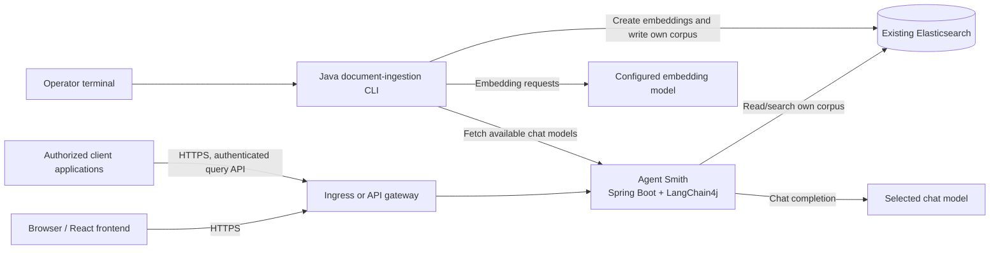

# Agent Smith RAG Architecture Plan

## 1. Purpose and current baseline

Add retrieval-augmented generation (RAG) to Agent Smith without replacing the
existing application stack:

- Java 25 and Maven.
- Spring Boot 4.1.1 with the existing MVC and Actuator starters.
- LangChain4j 1.22.0, including the existing Gemini chat-model integration.
- The React/Vite frontend, packaged as Spring Boot static resources.
- An existing Elasticsearch service. Elasticsearch is external to this
  application and is not deployed as part of the Agent Smith containers.

The current application exposes `/descrivi` and `/moduli`; it does not yet
provide document ingestion, embeddings, vector retrieval, or a RAG API. Add a
separate Java terminal application to ingest documents. Agent Smith itself
retrieves its own corpus and generates answers; it does not ingest documents
or access other applications' RAG configuration.

## 2. Target architecture



Agent Smith serves the existing UI/API and the RAG query API in its Spring
Boot container. The companion CLI runs interactively on an authorized
operator's Ubuntu workstation or as an explicitly invoked one-shot container.
It is a separate executable entry point and security identity, not an
always-running service. Both programs use the existing Elasticsearch cluster
but receive different least-privilege credentials.

### Query flow

1. A client submits an authorized question to Agent Smith's RAG API.
2. Agent Smith embeds the question with the configured embedding model and
   searches only its own Elasticsearch index/alias.
3. Agent Smith passes the retrieved snippets and question to its selected chat
   model, then returns an answer and permitted source references.
4. Other applications query Agent Smith through this authenticated API; they
   do not receive Elasticsearch credentials or access the cluster directly
   through Agent Smith.

### Ingestion flow

1. The operator launches the CLI and enters a document directory. Provide
   directory-name tab completion and a clear way to confirm the resolved path
   before ingestion begins.
2. The CLI retrieves the same available chat-model catalog exposed by Agent
   Smith's `/moduli` endpoint and displays letter/model choices in multiple
   columns. The complete menu must fit within 80 terminal columns; wrap long
   model names rather than truncating them. The operator selects a letter, and
   the CLI saves that allowed chat-model identifier as Agent Smith's RAG
   answer model through an operator-authorized configuration operation. This
   selection is not used as the embedding model.
3. The CLI recursively enumerates supported text/code documents, reports
   unreadable/unsupported files, and ingests each file as a standalone
   document. A file of 5,000 bytes or fewer is one snippet. Larger files are
   split with overlap at suitable technical boundaries, preserving source and
   location metadata.
4. The CLI generates vectors with a separately configured embedding model and
   writes chunks to Agent Smith's dedicated Elasticsearch index/alias.

Use the LangChain4j integrations compatible with version 1.22.0 for the
Elasticsearch store and embedding provider. The existing Gemini chat
dependency does not by itself provide vector storage or an embedding model.
Confirm the Elasticsearch server version, vector capabilities, embedding
dimensions, and similarity metric before fixing the index mapping.

## 3. Elasticsearch isolation and access

Elasticsearch is shared infrastructure; access is isolated by application and
by operation:

- Provision an Agent Smith-only index family, for example
  `agentsmith-rag-v1-*`, and a stable alias for its active corpus. Keep names
  configurable but validate the required Agent Smith prefix at startup and
  before CLI writes. Never allow a user-supplied arbitrary index name.
- Give the Agent Smith runtime a dedicated read/search-only role scoped to
  this index family. It must not write, administer the cluster, or access
  other applications' indices, aliases, templates, or RAG configuration.
- Give the ingestion CLI a separate service identity with only the required
  document/index write privileges on the Agent Smith index family. Do not
  grant cluster administration or access to other applications' domains.
- Do not store prompts, pipeline settings, or model configuration by
  discovering other applications' Elasticsearch data. Agent Smith's
  configuration belongs to its own deployment and configuration.
- Require TLS with certificate verification. Inject Elasticsearch and model
  credentials at runtime from a secret store or local environment; never put
  them in source control, frontend assets, image layers, Docker build
  arguments, or logs.
- Require authenticated and authorized callers for RAG queries. Restrict
  document ingestion to the CLI/operator role. The current project does not
  define API authentication, so implementing this boundary is a prerequisite
  for enabling remote consumers or exposing ingestion.
- Verify that Agent Smith can search its corpus but cannot write to it or
  access another application's documents/configuration; verify that the CLI
  can write only to the Agent Smith domain; verify unauthenticated and
  unauthorized API requests are rejected.

Treat indexed documents as untrusted input. Limit file types and sizes,
validate metadata and source identifiers, avoid unsafe/executable parsing, and
instruct the model to treat retrieved text as reference material, not
instructions. Return only source metadata that the caller may see.

## 4. Ubuntu development environment

Use Ubuntu 24.04 LTS or a later supported Ubuntu release. Install Git, Maven,
Docker Engine, and the Docker Compose plugin:

```sh
sudo apt update
sudo apt install -y git maven docker.io docker-compose-v2
```

Install a Java 25 JDK. If available from the configured Ubuntu package sources:

```sh
sudo apt install -y openjdk-25-jdk
```

Otherwise, install Temurin 25 by following the official Adoptium instructions
for Debian/Ubuntu. Select Java 25 as the active JDK and set `JAVA_HOME` to its
installation directory. Use `sudo docker ...` if the user is not configured
for Docker access; membership in the `docker` group grants root-equivalent
privileges.

Verify the environment:

```sh
java -version
mvn -version
git --version
docker version
docker compose version
```

The Maven frontend plugin installs the pinned Node.js 22.22.1 and npm 10.9.4
for the frontend build. Install Node.js 22 and npm separately only when
developing the frontend with its standalone Vite commands.

Supply local secrets via shell environment or an ignored local environment
file; do not commit them. Example values (use the authentication method
provisioned for the relevant identity):

```sh
export GEMINI_API_KEY='...'
export ELASTICSEARCH_URL='https://your-elasticsearch-host:9200'
export AGENTSMITH_ES_API_KEY='...'
export RAG_INDEX_ALIAS='agentsmith-rag-v1'
export EMBEDDING_MODEL='...'
```

The runtime and CLI use separate Elasticsearch credentials. Add typed Spring
configuration for the Agent Smith service and explicit CLI configuration for
the ingester. Configure the embedding provider/model independently from the
chat model catalog. Missing required configuration must produce a clear
startup or command error; never fall back to an unscoped index.

Build and run Agent Smith:

```sh
mvn clean verify
mvn spring-boot:run
```

For frontend hot reload, run in a second terminal:

```sh
npm --prefix frontend ci
npm --prefix frontend run dev
```

The Vite server proxies API requests to `http://localhost:8080` by default.
Run the CLI with the repository's documented Maven command after its entry
point is added. Ensure the workstation has an approved network path to the
existing Elasticsearch service; do not substitute an unsecured local
Elasticsearch instance.

## 5. Implementation steps

1. **Confirm compatibility and contracts.** Check the LangChain4j 1.22.0
   Elasticsearch store and embedding-provider modules, Elasticsearch server
   version and vector support, embedding dimensions, and selected similarity
   metric. Define the model-catalog contract the CLI will consume from
   `/moduli`, the selected chat-model configuration lifecycle, supported
   document types, and the 5,000-byte threshold.
2. **Provision the data boundary.** Have the Elasticsearch administrator
   create the dedicated index template/mapping, vector settings, alias, and
   two separate identities: Agent Smith read-only, and CLI write-scoped.
   Verify each identity has no privileges over other application domains.
3. **Implement and secure retrieval.** Add validated typed configuration,
   TLS-authenticated Elasticsearch access, query embedding, scoped vector
   search, and LangChain4j/Gemini answer composition. Preserve
   `/descrivi` and `/moduli`; add an authenticated RAG query endpoint with
   source references.
4. **Implement the separate Java ingestion CLI.** Add an independent entry
   point and configuration using the existing Java/Maven/LangChain4j stack.
   Fetch the model catalog from Agent Smith, render letter/model choices
   across multiple columns within 80 columns, and validate the user's choice.
   Save the selection through an operator-authorized Agent Smith configuration
   operation. Implement directory path tab completion (using a CLI-only
   terminal line-editing library if needed), path confirmation, recursive
   enumeration, supported text/code file handling, and clear per-file
   progress and error reporting.
5. **Implement chunking and indexing.** Store files at or below 5,000 bytes
   as one snippet. For larger files, split with overlap at code/technical
   boundaries and preserve path, file identity, chunk location, and version
   metadata. Generate vectors with the separately configured embedding model.
   Use stable IDs/upserts and define re-ingestion and deletion so stale chunks
   are removed.
6. **Connect model selection to answer generation.** Persist the chosen
   chat-model identifier in Agent Smith's own configuration mechanism, not in
   another application's Elasticsearch configuration. Define whether that
   selection is an operator default or a request-level option, and ensure the
   query API can only select models Agent Smith exposes through `/moduli`.
7. **Add tests.** Unit-test menu width/layout and selection, directory
   completion and validation, traversal and file handling, byte-threshold
   behavior, chunking/overlap, stable IDs, and error reporting. Test retrieval,
   source attribution, API authorization, unchanged existing endpoints, and
   Elasticsearch role boundaries with an isolated test index or provisioned
   test identities. Include negative cross-application access tests.
8. **Operationalize.** Add separate readiness/liveness reporting, redacted
   structured logs, size limits, timeouts, and metrics for ingestion,
   retrieval, model latency, and failures. Document index mapping/alias
   migrations, re-ingestion, and rollback.
9. **Build and release.** Build and test the Java application and frontend;
   publish an immutable Agent Smith image. Package the CLI as a separate
   executable artifact or one-shot image. Inject distinct least-privilege
   secrets at runtime and deploy Agent Smith behind TLS-terminating ingress.

## 6. Docker deployment architecture

```text
Browser and authorized client applications
                    |
          HTTPS ingress / gateway
                    |
       Agent Smith application container
       - Java 25 / Spring Boot
       - packaged React UI and API
       - LangChain4j retrieval + chat
          |                     |
          | read own corpus     | HTTPS chat requests
          v                     v
 Existing Elasticsearch     Configured chat provider
 (TLS, Agent Smith role)
          ^
          | writes own corpus with separate CLI identity
 Java ingestion CLI (operator workstation or one-shot container)
          |
          +---- embedding requests ---> Configured embedding provider
```

### Container and runtime responsibilities

- Deploy Agent Smith as a stateless Java 25 web application image. The React
  frontend is already built by Maven and packaged as Spring Boot static
  resources; it does not need a separate production container.
- Keep Elasticsearch external and separately operated. Do not add a new
  Elasticsearch node to Agent Smith's Docker Compose deployment.
- Run Agent Smith on port 8080 behind TLS ingress/API gateway; do not expose
  the application or Elasticsearch directly to the public internet. Apply
  network rules that allow only required ingress and outbound dependencies.
- Run the ingestion CLI interactively on an operator workstation by default.
  If containerized, run it as a one-shot command/job with a terminal attached,
  a document directory, and getting the secrets from environment varialbes. 
  Do not bake credentials/documents into the executable image.
- Run containers as non-root with a read-only filesystem where practical.
  Provide health/readiness probes and ensure logs and health endpoints never
  expose credentials or retrieved document content.
- Inject the Gemini, embedding-provider, and Elasticsearch settings at
  runtime. Never pass secrets through Docker build arguments, frontend
  variables, image labels, or committed Compose files.
- Use environment variables to pass the secrets to ther app, and use the host 
  environment variables to set the environment variables in the docker image

Before release, align the checked-in Docker packaging: `pom.xml` names the
artifact `AgentSmith.jar`, but `src/main/docker/Dockerfile.txt` currently
copies `ClientAI.jar`. Update the image build to use the actual packaged
artifact, and verify Maven Docker/ZIP packaging does not rely on the stale
filename. `src/main/docker/Dockerrun.aws.json` declares port 8080; retain that
port if Elastic Beanstalk remains a deployment target.
